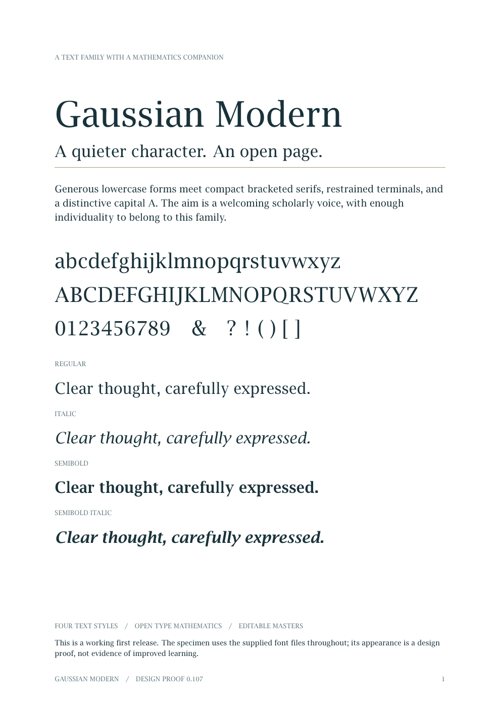

# Gaussian Modern

A serif text family with an OpenType mathematics companion, by Andrew Cavallaro.

**Development release 0.107 · 18 October 2026**



Gaussian Modern takes its upright proportions, serifs and terminals in part from
the roman type of C. F. Gauss, *Werke*, Band III (Göttingen, 2nd printing 1876).
Those Gauss-modelled shapes were produced with METAFONT programs built on Donald
Knuth's Computer Modern, included under `source/metafont/`.

## License

Original font work, sources, project code, and documentation are released under
[MIT](LICENSE). Inherited Computer Modern material retains Knuth's notices and the
requirement to rename modified files/packages. See [LICENSE.md](LICENSE.md) and
[THIRD-PARTY-NOTICES.md](THIRD-PARTY-NOTICES.md) for the precise scope.

## Fonts

| Family | Styles | Unicode mappings per style |
| --- | --- | ---: |
| Gaussian Modern | Regular, Italic, Semibold, Semibold Italic | 303 |
| Gaussian Modern Math | Regular | 981 |

Both OTF and TTF are included. Install **one format**, using the five files in
`fonts/otf/` or `fonts/ttf/`; installing both can create duplicate menu entries.
The mathematical companion has 2,403 glyphs, including unencoded size variants
and assembly parts.

The current design keeps a distinctive A, rounded Q tails, smooth J hooks,
refined E/F front serifs, and a slightly stronger regular lowercase l. Text
features include kerning, common f-ligatures, tabular lining digits, and basic
combining-mark attachment.

## Preview

- [Reading and mathematics specimen](specimens/GaussianModern-Specimen.pdf)

## Build

Requires Python 3.10 or later. From this repository's root:

```sh
python -m pip install -r requirements.txt
python source/build.py
python source/validate.py
python scripts/check_identity.py
```

To build from the editable UFO masters instead:

```sh
python source/build.py --from-ufo
```

Create a release archive with `python scripts/package.py`; the result is placed
in `dist/`.

Both routes write five OTF and five TTF files into `fonts/`. They use only the
included masters and FontTools; a METAFONT installation is not needed. Changes are not
synchronized automatically between JSON and UFO. See [CONTRIBUTING.md](CONTRIBUTING.md).

The METAFONT programs under `source/metafont/` build with TeX Live
(`mf '\mode=ljfour; input gwr10'`). They are kept as the origin of the
Gauss-modelled shapes; the JSON and UFO masters are authoritative for the fonts.

## Use with XeLaTeX

```tex
\usepackage{fontspec}
\usepackage{unicode-math}
\setmainfont{GaussianModern-Regular.otf}[
  Path=fonts/otf/,
  ItalicFont=GaussianModern-Italic.otf,
  BoldFont=GaussianModern-Semibold.otf,
  BoldItalicFont=GaussianModern-SemiboldItalic.otf]
\setmathfont{GaussianModernMath-Regular.otf}[Path=fonts/otf/]
```

To regenerate the specimen, run `xelatex GaussianModern-Specimen.tex` from
`specimens/`, with fontspec, unicode-math, and the document's other packages
installed. The supplied specimen has been checked in XeTeX; other math layout
engines have not yet been qualified.

## Repository contents

| Path | Contents |
| --- | --- |
| `fonts/` | Ten installable OTF/TTF files |
| `source/masters/` | Cubic JSON masters and MATH layout data |
| `source/ufo/` | Editable UFO 3 masters |
| `source/features/` | OpenType feature definitions |
| `source/metafont/` | METAFONT programs for the Gauss-modelled roman (Computer Modern based) |
| `specimens/` | PDF, TeX, preview, and historical design proofs |
| `.github/workflows/build.yml` | JSON/UFO build and validation checks |

See [GITHUB.md](GITHUB.md) for repository setup, [CHANGES.md](CHANGES.md) for
revision history, and [VALIDATION.md](VALIDATION.md) for checks and limitations.

## Development limits

This is a working design release. Dedicated screen hinting, optical sizes,
small capitals, broader language proofing, and cross-engine math qualification
remain future work. Combining-mark support handles basic single accents, not
arbitrary stacked accents. Some source math variants remain unencoded, listed
in `source/math-unencoded.txt`. No controlled reading or learning study has
validated the design.
